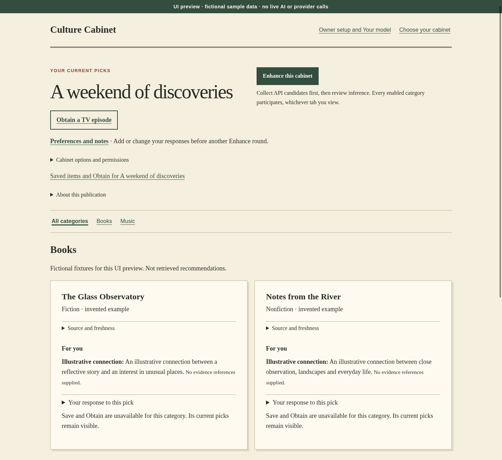

# Culture Cabinet

**A personal R&D project in AI-assisted cultural discovery.**

Books, films, television, music, art and events in one local-first cabinet.
The aim is to turn deliberate preferences into useful discoveries, with clear
sources, understandable recommendations and control over what is shared.

Built by [Adam Taylor](https://github.com/adambtaylor) as an exploration of
AI-assisted software development, product design and careful integration work.

[Explore the code](#a-short-code-tour) · [Development status](#project-status) ·
[Preview the interface](#explore-locally) · [Technical notes](docs/README.md)

*UI preview from the actual Django templates and styles, using entirely fictional
sample data. This is a static render, not a live AI run. [How it was made](docs/showcase/README.md).*

## What the project explores

- **Taste across different media.** Keep interests, experienced enjoyment,
  notes and saved items distinct, rather than turning every click into a like.
- **Source-backed discovery.** Collect catalogue identities and provenance
  before interpreting preferences. Source freshness and unavailable categories
  remain visible.
- **Explainable AI.** Explore taste associations while separating explicit
  human feedback from inferred connections. A model's explanation is not a
  new source fact.
- **Deliberate data sharing.** Preview source and model requests, keep their
  permissions separate, and avoid treating configuration as consent.
- **A considered interface.** A paper-and-ink visual style, server-rendered
  pages and clearly labelled feedback controls.

The wider codebase also explores cultural outings, event sources and local
library handoffs. These are development areas, not promises of universal
provider support or a finished service.

## Engineering focus

**Python · Django · SQLite · HTML/CSS · JavaScript · API integration**

The interesting work lives at the boundaries: between local state and a provider,
a user's response and a model's inference, or an interrupted operation and a
safe retry.

The intended Enhance workflow is:

1. Record explicit preferences.
2. Review and collect permitted source candidates.
3. Review the model request.
4. Validate and publish grounded picks.
5. Save reactions for a later round.

The implementation includes typed feedback events, source adapters, request
disclosures, persisted operation state, stale-state checks and partial-failure
handling. Tests use synthetic fixtures so development does not depend on
personal histories or paid inference.

## A short code tour

| Area | Start here |
| --- | --- |
| Enhance coordination and publication | [portable_enhance_service.py](backend/shelf/portable_enhance_service.py), [enhance_coordinator.py](backend/shelf/enhance_coordinator.py) |
| Taste and recommendation explanations | [synthesis.py](backend/shelf/synthesis.py), [for_you.py](backend/shelf/for_you.py) |
| Feedback and its meaning | [feedback.py](backend/shelf/feedback.py), [feedback_scale.py](backend/shelf/feedback_scale.py) |
| Source policy and integration boundaries | [native_source_policy.py](backend/shelf/native_source_policy.py), [discovery_sources.py](backend/shelf/discovery_sources.py) |
| Local runtime and owner setup | [portable_runtime.py](backend/cabinet/portable_runtime.py), [portable.py](backend/portable.py) |
| Interface | [Django templates](templates/cabinet/), [styles and scripts](static/) |
| Tests | [Service, HTTP, provider and feedback tests](backend/shelf/tests/) |

## Project status

**Active prototype. Not a production release.**

There is substantial implementation and synthetic test coverage, but working
live end-to-end inference and a clean-machine, ordinary-user experience are not
established by this repository or the screenshot. Provider availability, source
rights and runtime setup need their own validation.

[DEVELOPMENT-STATUS.md](DEVELOPMENT-STATUS.md) preserves the original export's
validation history and known limits. Later commits should be assessed on their
own review and test evidence; historical results are not a current all-green
test report.

## Explore locally

The smallest way to inspect the interface is the
[static synthetic preview](docs/showcase/README.md). It needs Django, but no
database, API keys, network requests or running application.

For application work, read the [portable setup notes](docs/portable-preview.md)
and [dependency inventory](DEPENDENCIES.md) first. The development environment
is Linux ARM64 with Python 3.14 and pinned Django dependencies. Some legacy
entry points intentionally enforce local runtime boundaries; do not bypass
those guards or point test tools at a personal database.

This is a developer project, not a one-command installation or hosted demo.

## Collaboration

Small, focused changes are easier to understand and review. Include the problem,
the affected behavior and the checks you actually ran. Keep synthetic tests,
live-provider checks and end-to-end results separate. Open pull requests as
drafts until their scope and evidence are ready for review.

Do not commit credentials, personal databases, private histories, account
exports or unlicensed artwork. Provider access and paid requests require their
own authorization.

## License and third-party material

No open-source license has been selected for the application. Public visibility
allows the project to be inspected; it does not itself grant a general license
to reuse or redistribute it.

Dependency licenses and notices are in [THIRD_PARTY_NOTICES.txt](THIRD_PARTY_NOTICES.txt).
GeoNames postcode data has [separate attribution and provenance](backend/shelf/data/geonames-au-postcodes.manifest.json).
Provider data, excerpts and artwork remain subject to their own rights and
terms. The portfolio screenshot contains invented text fixtures and no
third-party artwork.
